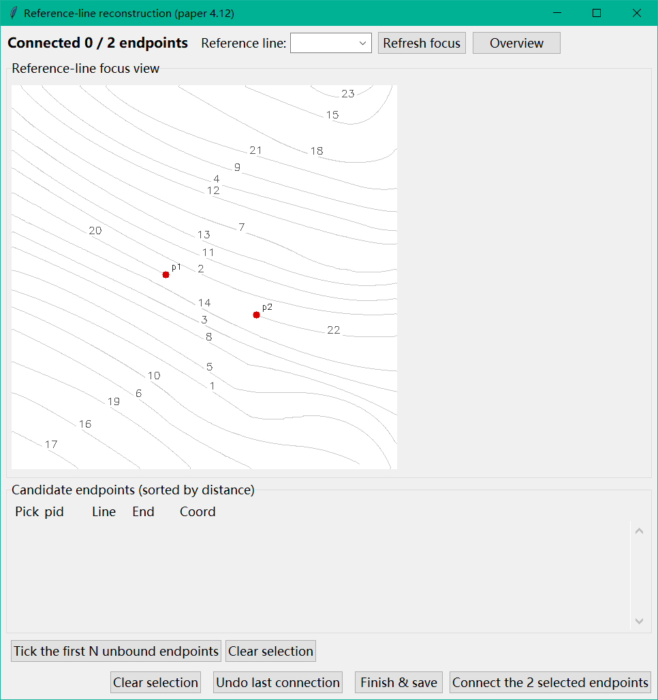
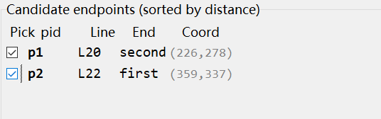
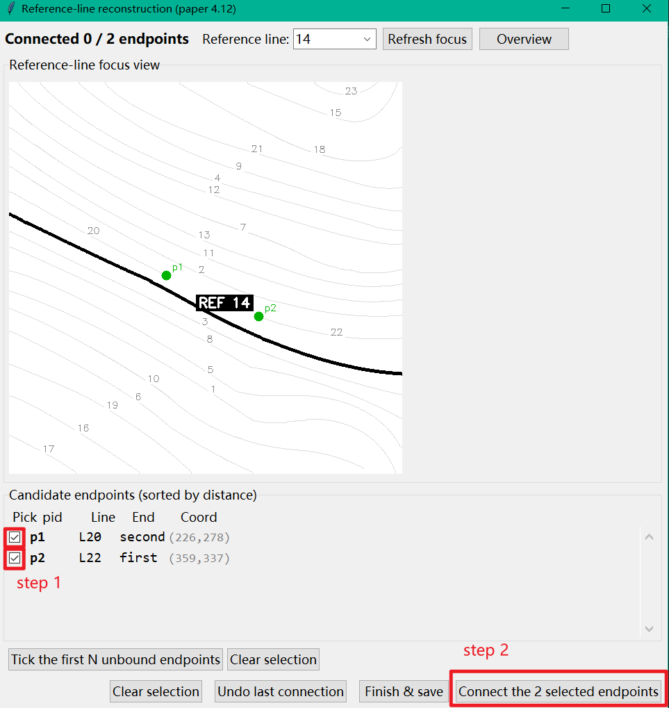

# Rule-Based and Metaheuristic Contour-Line Reconstruction Toolkit

> **Rule-Based and Metaheuristic Contour-Line Reconstruction Toolkit**

This repository is a Python implementation of the paper *"Contour-line reconstruction based on neighbouring geometric features"*:

**The input data must be a pre-extracted skeleton image of broken contour lines** (white-background, black-lines grayscale/binary image). This tool reconstructs such skeleton images through a three-phase approach:

1. **Breakpoint detection and direction matching** — identifies skeleton line endpoints and pairs them by geometric direction;
2. **Simulated annealing** — globally searches for further gap-filling connections via a cost function;
3. **Semi-manual reference-line algorithm** — the user selects a reference line; the program generates a smooth curve between two endpoints along the reference line's geometric direction.

Outputs are ready-to-use vectorized contour JSON and visualization PNG files.

> **Important Prerequisite — Input Data Requirements**

> The pipeline (especially steps 2–8) assumes the input is a **pre-extracted, clean contour skeleton image**, i.e. a **white-background, black-lines** grayscale/binary image: white background RGB≈255, contour pixels RGB≈0, line width 1 pixel, **no legends, features, text, shadows, color rendering, or other noise**.

> Feeding in a raw terrain scan or a colored topographic map directly will cause step 1 skeleton extraction to produce excessive artifacts and false detections, rendering all subsequent breakpoint detection, simulated annealing, and reference-line reconstruction ineffective or wrong.

> **Correct approach**:
>
> - If you already have a clean white-background, black-line skeleton image, pass it as `--image` directly;
> - If you only have a raw scan or colored topographic map, first use external tools (Photoshop / GIMP / Illustrator / OpenCV custom scripts, etc.) to **manually binarize and extract the skeleton**, then feed the resulting white-background, black-line image in.

---


## 1. What Does This Do


| Step | Content                                                      | Key Module                              |
| ---- | ------------------------------------------------------------ | --------------------------------------- |
| 1    | Skeleton extraction                                          | `src/skeleton_extraction_v2.py`         |
| 2    | v4 breakpoint detection + geometric matching connection      | `src/breakpoint_v4_debug.py`            |
| 3    | Merge skeleton with v4 connection curves                     | `src/merge_skeleton_and_connections.py` |
| 4    | Extract connected line segments                              | `src/extract_connected_lines.py`        |
| 5    | Simulated annealing (SA) for further gap filling             | `src/simulated_annealing.py`            |
| 6    | One-shot merge of skeleton + v4 + SA                         | `src/merge_skeleton_and_connections.py` |
| 7    | Splice v4 line segments into long lines using SA connections | `src/merge_sa_into_lines.py`            |
| 8    | Reference-line-assisted reconstruction (interactive GUI)     | `src/reference_line_reconstruction.py`  |


The full pipeline is orchestrated by `pipeline.py`.

---


## 2. Directory Structure

```
Tmap_feature_extraction/
├── pipeline.py                              # Main entry: runs all 8 steps in one shot
├── requirements.txt                         # Dependency list
├── README.md / README_EN.md                 # This documentation
│
├── src/                                     # Source code (imported by pipeline via sys.path)
│   ├── BezierCurve.py                       #     Bezier curve evaluation / projection / tangent tools
│   ├── skeleton_extraction_v2.py            #     Step 1
│   ├── breakpoint_v4_debug.py               #     Step 2
│   ├── merge_skeleton_and_connections.py    #     Steps 3, 6
│   ├── extract_connected_lines.py           #     Step 4
│   ├── simulated_annealing.py               #     Step 5
│   ├── merge_sa_into_lines.py               #     Step 7
│   └── reference_line_reconstruction.py     #     Step 8 (Tkinter GUI)
│
├── test_data/                               # Test images (organized by map sheet)
│   ├── 25-Vynikal/
│   │   └── figure6_skeketon.jpg             # Same as paper figure 6, 117 KB
│   └── 26-Kong/
│       └── Fracture Image.jpg                # Dense-fracture example, 79 KB
│
├── result/                                  # Pre-generated result examples (for comparison)
│   ├── 25/
│   │   ├── breakpoint_v4_debug.png          # Step 2 debug image
│   │   ├── annealing_debug.png              # Step 5 SA debug image
│   │   ├── annealing_clean.png              # Step 5 clean skeleton
│   │   ├── reference_reconstruction_clean.png  # Step 8 output (if GUI was launched)
│   │   ├── reconstruction_result.png        # Final result (= copy of the last step's output)
│   │   └── temp/                            # All intermediate JSON / mask files
│   └── 26/
│       ├── breakpoint_v4_debug.png
│       ├── annealing_debug.png
│       ├── annealing_clean.png
│       ├── reconstruction_result.png
│       └── temp/
```

> **Data convention**: each subdirectory under `test_data/` corresponds to one contour map sheet,
> the subdirectory name (`25-Vynikal`, `26-Kong`) is the sheet ID; it currently holds one JPG.
> Results are written to the same-named `result/<sheet-id>/` folder, enabling side-by-side comparison across sheets.

---


## 3. Installation


### 3.1 Set Up Python Environment

Create a dedicated conda environment named `contourReconstruction` with Python 3.8:

```powershell
conda create -n contourReconstruction python=3.8 -y
conda activate contourReconstruction
```

After activation, `(contourReconstruction)` will appear at the prompt, and all subsequent `python` commands will use this environment's interpreter.

### 3.2 Install Dependencies

With the environment activated, run:

```powershell
python -m pip install -r requirements.txt
```


### 3.3 Key Dependencies (see `requirements.txt`)


| Package                 | Pinned version | Purpose                                                                                       |
| ----------------------- | -------------- | --------------------------------------------------------------------------------------------- |
| `opencv-contrib-python` | 4.9.0.80       | Binarization, connected components, `cv2.ximgproc.thinning` (**must be the contrib version**) |
| `numpy`                 | 1.24.4         | Numerical computation                                                                         |
| `matplotlib`            | 3.7.4          | Debug visualizations, comparison charts                                                       |
| `Pillow`                | 10.2.0         | Tkinter GUI PNG loading                                                                       |
| `scipy`                 | 1.10.1         | `BezierCurve.py` uses `simps` / `minimize` / `comb`                                           |


The remaining packages in `requirements.txt` (`contourpy`, `cycler`, `fonttools`, `importlib_resources`, `kiwisolver`, `packaging`, `pyparsing`, `python-dateutil`, `six`, `zipp`) are indirect dependencies pulled in by matplotlib / numpy and do not need to be installed explicitly.

---


## 4. Quick Start


### 4.1 Command-Line Syntax

```text
python pipeline.py --image <input.jpg> --output-dir <result_dir>
```


| Argument       | Required | Description                                                           |
| -------------- | -------- | --------------------------------------------------------------------- |
| `--image`      | Yes      | Absolute or relative path to the input image                          |
| `--output-dir` | Yes      | Output directory; user-facing PNGs (outside `temp/`) are written here |


### 4.2 Run the Full Pipeline (Example)

```powershell
python `
    pipeline.py `
    --image   "test_data/25-Vynikal/figure6_skeketon.jpg" `
    --output-dir "result/25"
```

After completion, `result/25/` will contain 5 PNG files (see §2), and `result/25/temp/` will hold all intermediate JSON files.

---


## 5. Output Overview

Only a few user-facing PNGs land in `output-dir/`; everything else goes into `temp/`.

```
output-dir/
├── breakpoint_v4_debug.png              <- Step 2 debug image (copied from temp/)
├── annealing_debug.png                  <- Step 5 SA debug image
├── annealing_clean.png                  <- Step 5 clean skeleton (white background, black lines)
├── reference_reconstruction_clean.png   <- Step 8 output (only if GUI was actually launched)
├── reconstruction_result.png            <- Final result: if step 8 ran, = ref_recon_clean;
│                                          otherwise = annealing_clean
└── temp/
    ├── skeleton_data.json
    ├── breakpoint_v4_result.json
    ├── breakpoint_v4_filtered_endpoints.json
    ├── breakpoint_v4_filter_compare.png
    ├── connected_skeleton_v4.png
    ├── merged_skeleton_data_v4.json
    ├── merged_skeleton_mask_v4.png
    ├── connected_lines_v4.json
    ├── sa_result.json
    ├── annealing_connections.json
    ├── annealing_result.png
    ├── annealing_direction_codes.png
    ├── merged_skeleton_data.json
    ├── merged_skeleton_mask.png
    ├── connected_lines_sa_merged.json
    ├── reference_reconstruction_result.json
    ├── reference_reconstruction_vis.png
    ├── reference_lines_overview.png
    └── _focus_tmp.png
```

---


## 6. Step 8 — Interactive Reference-Line Reconstruction: Operations Guide

> This step **automatically launches a Tkinter window**.
> The GUI only appears when step 7 has completed and there are still unmatched non-boundary endpoints remaining.
> If all endpoints have been paired, step 8 is skipped automatically and the final image reuses `annealing_clean.png`.

> **Important — Reference Line Selection Requires Expert Human Judgment**

> All geometric calculations in step 8 (Bezier fitting, same/opposite-side judgment, connection curvature)
> are built on the premise that the **current reference line shares the same orientation and is nearly parallel
> to the two endpoints you intend to connect**.
>
> **Choosing the wrong reference line** — for example:
>
> - A line at a large angle to the endpoint orientation;
> - A line that crosses multiple contour lines;
> - A line itself broken by noise and no longer straight;
>
> — will cause the program to generate smooth curves along the wrong direction, **completely invalidating the reconstruction result**, or even forcing endpoints from different contour lines to be joined together.
>
> Therefore, you **must NOT blindly click "Tick the first N unbound endpoints" to auto-select**.
> A person familiar with the map sheet must **manually judge** the reference line and endpoint combination based on the original map.
> Before clicking **Connect the 2 selected endpoints**, always:
>
> 1. Visually confirm on the original map that the reference line and the two endpoints share the **same orientation**;
> 2. Check that the red preview curve **follows the real contour trend** without obvious deviation;
> 3. If there is deviation, immediately **Undo last connection** and try a different reference line or different pair of endpoints.


### 6.1 Window Layout



```
┌────────────────────────────────────────────────────────────────────────────┐
│ Connected 3 / 12 endpoints   Reference line: [▼ L7 ]  [Refresh] [Overview] │ ← toolbar
├────────────────────────────────────────────────────────────────────────────┤
│                                                                            │
│                  Reference-line focus view  (image area)                   │
│      Bold black: current reference line L7;  grey: other contours          │
│      Blue dots: unbound endpoints on the same side;  red: opposite side; │
│      green: direction uncertain                                            │
│                                                                            │
├────────────────────────────────────────────────────────────────────────────┤
│ Candidate endpoints (sorted by distance)                                  │
│   ☐   pid   Line   End   Coord                                             │
│   ☐   p1    L3    first  (120, 200)                                        │
│   ☑   p2    L7    second (340, 180)   ← checked                            │
│   ☑   p5    L12   first  (355, 195)   ← checked                            │
│   ...                                                                      │
│  ── Connected (2) ──                                                       │
│       p3   L9    first  <-> p7                                              │
│       p4   L9    second <-> p11                                             │
├────────────────────────────────────────────────────────────────────────────┤
│ [Tick the first N unbound endpoints]   [Clear selection]                   │
│                                                                            │
│   [Clear selection] [Undo last connection] [Finish & save]                 │
│                            [Connect the 2 selected endpoints]              │
└────────────────────────────────────────────────────────────────────────────┘
```


### 6.2 Workflow


#### Step A — Select the Reference Line

1. In the **Reference line** dropdown (top-right), select an **existing** contour line ID as the reference.
  > Selection criterion: spatially parallel / co-oriented with the two endpoints you intend to connect.
2. The program immediately:
  - Draws the reference line **bold black** on the image; other lines are faded to light grey.
  - For each candidate non-boundary endpoint, computes:
    - The **nearest projection point Q** on the reference line's Bezier curve,
    - The **normal distance** (in pixels) from endpoint to projection point,
    - A 2D cross-product of endpoint position and tangent direction to determine **same side / opposite side / uncertain**,
    - Sorts endpoints by **distance**, listed in the panel below.
  [Focus view example](docs/images/gui_focus_view.png)


#### Step B — Check Two Endpoints to Connect

1. In the "Candidate endpoints" list, find two non-boundary endpoints that **belong to different original line segments**.
2. Check the checkboxes on the far left. The list refreshes in real time; connected endpoints are automatically moved to the grey section below.
3. Quick operations:
  - **Tick the first N unbound endpoints**: auto-checks the first N sorted endpoints (default N=2 in this workflow).
  - **Clear selection**: unchecks all boxes.
  - If both selected endpoints come from the same line (same `line_id`), the program refuses the connection and shows a prompt.
   


#### Step C — Connect

1. Click **Connect the 2 selected endpoints** (bottom-right).
2. The program generates a smooth curve (Bezier + linear offset) between the two points along the reference line's geometry,
  then merges the curve pixels into both original line segments, **splicing them into one new line segment**.
3. A success prompt appears: endpoint status switches to "used", list updates automatically.
4. In the image area, the newly generated curve is shown in **red**; connected endpoints turn grey.
5. **Repeat steps B/C** until all non-boundary endpoints are connected.
  


#### Step D — Undo / Clear


| Button                   | Behavior                                                                                 |
| ------------------------ | ---------------------------------------------------------------------------------------- |
| **Undo last connection** | Undoes the most recent connection: red curve disappears, both endpoints return to unused |
| **Clear selection**      | Clears all checkboxes; does not affect already-completed connections                     |


#### Step E — Save and Exit

1. Click **Finish & save** (bottom).
2. A confirmation dialog appears: if there are still unconnected endpoints, it asks whether to **save and exit**. Click Yes — remaining endpoints are recorded in the JSON but not rendered.
3. Three artifacts are automatically saved to `temp/` and copied to `output-dir/`:
  - `reference_reconstruction_result.json` — complete connection result (with Bezier curve coordinates for each segment)
  - `reference_reconstruction_vis.png` — visualization (grey lines + red connections + blue/green endpoints)
  - `reference_reconstruction_clean.png` — clean skeleton image (white background, black lines, contours connected)
4. `output-dir/reconstruction_result.png` is automatically updated to this last image.


### 6.3 FAQ


| Symptom                                                         | Troubleshooting / Action                                                                                                                           |
| --------------------------------------------------------------- | -------------------------------------------------------------------------------------------------------------------------------------------------- |
| GUI did not appear                                              | All endpoints were resolved by SA after step 7; the program skipped the GUI automatically. Check `temp/connected_lines_sa_merged.json` to confirm. |
| Prompt "Both endpoints must belong to different original lines" | Do not connect endpoints within the same original line segment.                                                                                    |
| Prompt "Please select a reference line in the dropdown first"   | You must select a reference line in the dropdown before side calculations are performed.                                                           |
| Red curve clearly deviates from the reference line direction    | The current reference line is incorrect; try a different one or adjust the selected endpoints.                                                     |


---


## 7. Minimal Commands to Reproduce the Paper Results

Ensure the target Python environment is active (see §3.1), then choose one:

```powershell
# Sheet 25-Vynikal
python pipeline.py --image "test_data/25-Vynikal/figure6_skeketon.jpg" --output-dir "result/25"

# Sheet 26-Kong
python pipeline.py --image "test_data/26-Kong/Fracture Image.jpg"      --output-dir "result/26"
```

`result/25/` and `result/26/` already contain the most recent outputs for all PNGs, which can serve as a baseline for comparison.

---


## 8. Citation & License

### Citation

If you use this code in a research paper, please cite both the original paper and this repository:

**Paper** (fill in your details):
> [AUTHORS]. "[PAPER TITLE]." [JOURNAL/CONFERENCE], [YEAR]. DOI: [YOUR DOI]

**Repository**:
> [AnastasiaNiu]. "[contourLineRestruction]." GitHub repository, [YEAR]. https://github.com/AnastasiaNiu/contourLineRestruction

### License

This project is licensed under **CC BY-NC 4.0** (Attribution-NonCommercial 4.0 International).

This license permits academic and non-commercial use only. Commercial use is prohibited. See the `LICENSE` file for full terms.

